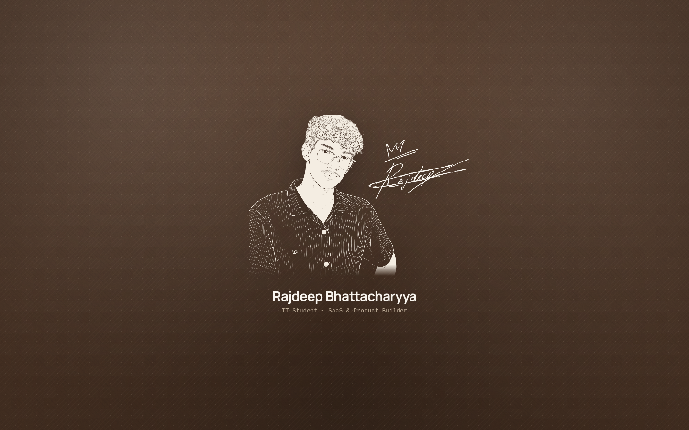
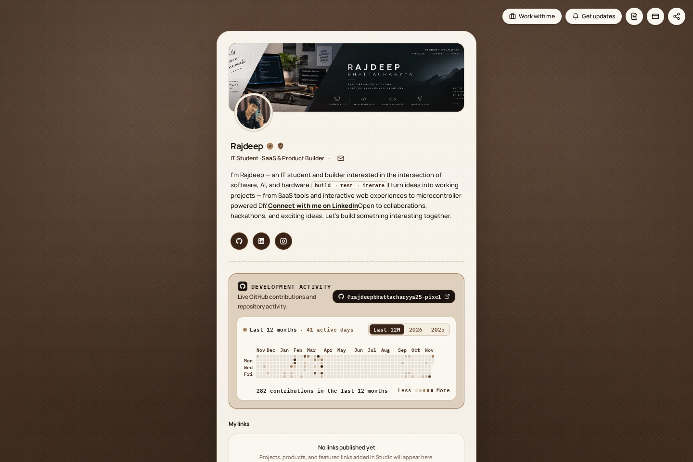
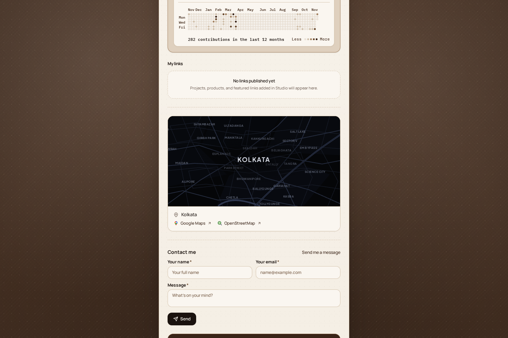
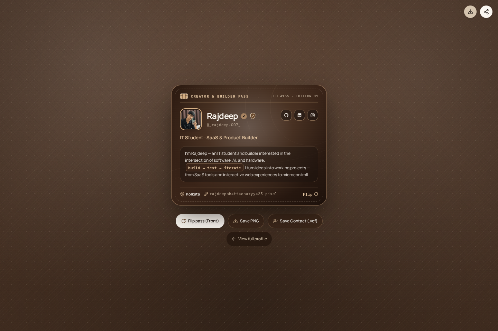
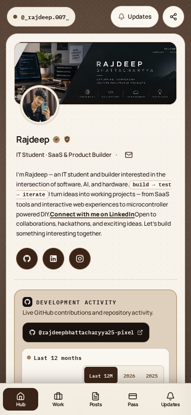
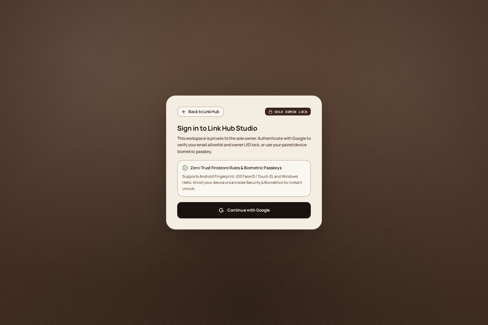
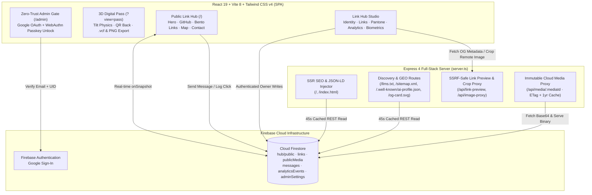

<div align="center">

# Link Hub — Personal Portfolio, Digital Pass & Design Studio

**High-craft, self-hosted personal developer portfolio, interactive 3D builder pass, live GitHub activity tracker, Pantone Color Institute® design system studio, and zero-trust admin workspace.**

[](https://rajdeepbhattacharyya-linkhub.vercel.app)
[](https://react.dev/)
[](https://www.typescriptlang.org/)
[](https://tailwindcss.com/)
[](https://firebase.google.com/)
[](https://rajdeepbhattacharyya-linkhub.vercel.app)

---

### 🌐 Production & Discovery Links

| Environment / Endpoint | URL | Description |
| :--- | :--- | :--- |
| **Production App (Live)** | [**`https://rajdeepbhattacharyya-linkhub.vercel.app/RajdeepBhattacharyya-LinkHub`**](https://rajdeepbhattacharyya-linkhub.vercel.app/RajdeepBhattacharyya-LinkHub) | Primary public developer portfolio & link hub |
| **Interactive Digital Pass** | [**`.../pass`**](https://rajdeepbhattacharyya-linkhub.vercel.app/pass) | 3D tilt-reactive Creator & Builder Pass with camera-scannable ISO 18004 QR, `.vcf` & PNG export |
| **Work With Me** | [**`.../work`**](https://rajdeepbhattacharyya-linkhub.vercel.app/work) | Direct collaboration & inquiry page backed by Cloud Firestore |
| **Articles & Notes** | [**`.../posts`**](https://rajdeepbhattacharyya-linkhub.vercel.app/posts) | Technical articles and builder notes |
| **Solo Owner Studio** | [**`.../admin`**](https://rajdeepbhattacharyya-linkhub.vercel.app/admin) | Zero-trust Google Auth + WebAuthn Biometric Admin Studio with real-time cloud auto-save |
| **LLM Context (`llms.txt`)** | [**`.../llms.txt`**](https://rajdeepbhattacharyya-linkhub.vercel.app/llms.txt) | Concise AI/LLM discovery manifest with TL;DR, skills, projects & FAQ (GEO standard) |
| **Full LLM Profile (`llms-full.txt`)** | [**`.../llms-full.txt`**](https://rajdeepbhattacharyya-linkhub.vercel.app/llms-full.txt) | Full markdown dossier including articles, stack, and verified social links |
| **AI Profile JSON** | [**`.../.well-known/ai-profile.json`**](https://rajdeepbhattacharyya-linkhub.vercel.app/.well-known/ai-profile.json) | Structured machine-readable developer identity (`sameAs`, `knowsAbout`, FAQ, links) |
| **Dynamic OpenGraph Card** | [**`.../og-card.svg`**](https://rajdeepbhattacharyya-linkhub.vercel.app/og-card.svg) | Server-rendered 1200×630 SVG social card synced with active Pantone theme |
| **Sitemap & Robots** | [**`.../sitemap.xml`**](https://rajdeepbhattacharyya-linkhub.vercel.app/sitemap.xml) · [**`.../robots.txt`**](https://rajdeepbhattacharyya-linkhub.vercel.app/robots.txt) | Live XML sitemap & AI-friendly crawler rules welcoming Googlebot, GPTBot, ClaudeBot, PerplexityBot |

</div>

---

## 📸 Landing Page & Feature Screenshots

### 0. 1.3s Portrait Outline Sketch Loading Screen
> Custom 1.3-second entry screen rendered over the signature **PANTONE 19-1118 TCX** `.bg-espresso-canvas` textured backdrop, featuring a high-precision champagne-ivory portrait outline sketch of **Rajdeep Bhattacharyya**, animated copper progress hairline, and full name lockup.



---

### 1. Desktop Landing Page — Hero Identity, Socials & Live GitHub Activity
> Crafted on the signature **PANTONE 19-1118 TCX (Espresso Truffle & Champagne Cotton Paper)** color system with tactile suede canvas micro-texture, custom banner art, verified builder badges, and live multi-year GitHub contribution telemetry.



---

### 2. Location Cartography, Contact Inbox & Quick Options Footer
> Interactive dark-styled location cartography (Google Maps vector integration + custom radial dark-canvas fallback with direct Google Maps & OpenStreetMap deep links), honey-pot protected visitor messaging form, and compact footer navigation.



---

### 3. Interactive 3D Creator & Builder Pass
> Pointer-reactive 3D specular lighting, front/back flip physics, verifiable QR code & serial number, one-click high-DPI PNG pass download, and instant `.vcf` vCard contact export.



---

### 4. Mobile Responsive Experience & Zero-Trust Admin Studio Gate
> Adaptive mobile viewport with floating glassmorphic bottom dock (`Hub`, `Work`, `Posts`, `Pass`, `Updates`) alongside the hardware-backed WebAuthn Biometric & Solo Owner Google Auth gate.

| Mobile Landing Page (`390×844`) | Protected Solo Admin Studio Gate (`/admin`) |
| :---: | :---: |
|  |  |

---

## ✨ Key Architectural Highlights

### 🎨 Pantone Color Institute® Design System Studio
- **Signature Default Palette**: Ships with **PANTONE 19-1118 TCX · Espresso Truffle & Champagne Cotton Paper** (`#4A3324` canvas, `#F4EDE2` card surface, `#FAF6F0` alabaster inner bento cards, `#1A120E` espresso ink).
- **Algorithmic 8-Token Palette Synthesizer**: Enter any custom hex seed color or select from curated Pantone TCX chips to automatically compute a WCAG-compliant 8-token surface hierarchy across three paper harmony modes:
  - `Warm Paper` (Champagne cotton paper warmth)
  - `Tinted Paper` (Subtle chromatic paper tint derived from seed hue)
  - `Crisp Alabaster` (High-contrast gallery paper)
- **Live CSS Variable Injection**: Every surface, hairline border, badge, and server-generated `/og-card.svg` updates instantaneously.

### 🪪 Interactive 3D Digital Pass & vCard Generator
- **3D Tilt & Specular Glare**: Tracks pointer coordinates and keyboard arrow keys to render realistic card tilt and dynamic radial light reflections.
- **Dual-Sided Identity**: Front face displays avatar, bio, handle, location, and verified badges; back face renders a scannable QR code, edition serial number, and cryptographic-style pass metadata.
- **Offline Contact & Image Export**: Visitors can export the pass as a crisp PNG or download a standard `.vcf` vCard file directly into iOS/Android/macOS Contacts.

### 📊 Live GitHub Contributions & Repository Heatmap
- **Multi-Range Contribution Calendar**: Switch seamlessly between `Last 12M`, `2026`, and `2025` contribution graphs with automatic active-day and total-contribution counters.
- **Repository Commit Mode**: Optional `owner/repo` commit activity heatmap that aggregates live GitHub commits into a 52-week SVG grid with smart `localStorage` caching and graceful rate-limit handling.

### 🖼️ Bento Link Showcase & SSRF-Safe Link Preview Engine
- **Automatic OpenGraph Thumbnail Discovery**: Server-side `/api/link-preview` endpoint parses `<meta property="og:image">`, `twitter:image`, and `<link rel="apple-touch-icon">` with bounded streaming reads (stops at `</head>` or 256 KB) and a 6-hour LRU memory cache.
- **SSRF Protection**: `validatePreviewTargetUrl()` blocks loopback (`127.0.0.1`, `::1`, `localhost`), RFC 1918 private IPv4 ranges (`10.x`, `172.16-31.x`, `192.168.x`), link-local/cloud metadata endpoints (`169.254.169.254`), and `.internal`/`.local` hostnames on both initial request and HTTP redirects.
- **Interactive Image Crop Studio**: Built-in zoom, pan, and aspect-ratio cropper (`16:9` link cards, `3:1` cover banners, `1:1` avatars) powered by a CORS-safe `/api/image-proxy` and client-side WebP compression.

### 🔐 Zero-Trust Solo Admin & WebAuthn Biometric Passkeys
- **Dual-Layer Firestore Security Rules**: Write access to `hub/public`, `links/*`, `publicMedia/*`, and `adminSettings/*` is strictly locked to the verified owner email (`rajdeep.bhattacharyya25@gmail.com`) and permanently binds to the owner's `request.auth.uid` on first save.
- **Hardware Passkey Enrollment (`WebAuthn`)**: Enroll Android Fingerprint, iOS Face ID / Touch ID, or Windows Hello inside the Studio (`Security & Biometrics` tab) using platform authenticators (`navigator.credentials.create` / `navigator.credentials.get`) with challenge verification and device management.

### 🤖 Server-Side SEO & Generative Engine Optimization (GEO)
- **Live Firestore SSR Meta Injection**: `server.ts` fetches the latest `hub/public` and `links` documents via the Firestore REST API (with a 45-second edge cache) and injects dynamic `<title>`, `<meta name="description">`, OpenGraph, Twitter Cards, and a rich Schema.org `@graph` (`Person` + `ProfilePage` + `WebSite` + `ItemList`) directly into `index.html` before serving.
- **AI Crawler Discovery Endpoints**:
  - `GET /llms.txt` & `GET /llms-full.txt`: Structured Markdown summaries tailored for LLM agents, Perplexity, ChatGPT Search, and Claude.
  - `GET /.well-known/ai-profile.json`: Machine-readable JSON profile exposing developer bio, skills, social graph, and featured links.
  - `GET /sitemap.xml` & `GET /robots.txt`: Dynamic XML sitemap with explicit allow rules for `GPTBot`, `OAI-SearchBot`, `ClaudeBot`, `PerplexityBot`, `Google-Extended`, and `Applebot-Extended`.

---

## 🏗️ System Architecture



---

## 📂 Repository File Structure

```text
├── public/
│   ├── link-hub-config.json            # Static fallback / exportable hub configuration
│   └── screenshots/                    # Production landing page, pass, mobile & studio captures
│       ├── landing-page-desktop.png
│       ├── landing-page-contact-footer.png
│       ├── digital-pass-view.png
│       ├── landing-page-mobile.png
│       └── admin-studio-gate.png
├── src/
│   ├── components/
│   │   ├── AdminAuthGate.tsx           # Solo owner Google Auth + WebAuthn passkey login gate
│   │   ├── AdminInsightsTabs.tsx       # Visual analytics charts, inbox reader & dev diagnostics
│   │   ├── AdminPage.tsx               # Full Studio CMS (Identity, Links, Pantone, GitHub, Posts)
│   │   ├── BiometricSecurityTab.tsx    # WebAuthn passkey enrollment & paired device manager
│   │   ├── CardPreviewGraphic.tsx      # Custom SVG / thumbnail card art renderer
│   │   ├── ErrorBoundary.tsx           # Resilient React error boundary
│   │   ├── GitHubActivity.tsx          # Multi-year GitHub contribution & repo commit heatmap
│   │   ├── GoogleMapView.tsx           # Dark-mode Google Maps + custom vector canvas fallback
│   │   ├── ImageCropModal.tsx          # Interactive zoom/pan/aspect-ratio image cropper
│   │   ├── LinkBentoSection.tsx        # Categorized Bento grid, Featured Song synth & Map card
│   │   ├── PassView.tsx                # 3D interactive Creator Pass, QR code & vCard exporter
│   │   ├── SocialIcons.tsx             # Platform-matched SVG icon system
│   │   └── SubViewsAndModals.tsx       # Work With Me, Blog Reader, Updates & Share modals
│   ├── data/
│   │   └── profileData.ts              # Core TypeScript interfaces, Pantone tokens & normalization
│   ├── services/
│   │   ├── firebase.ts                 # Firebase App, Auth, Firestore & Analytics initialization
│   │   └── firebaseHubService.ts       # Real-time Firestore sync, media upload & analytics batching
│   ├── utils/
│   │   ├── biometricAuth.ts            # WebAuthn credential creation, challenge signing & verification
│   │   ├── biometricAuth.test.ts       # Unit tests for WebAuthn passkey utilities
│   │   ├── hubLogic.ts                 # Category filtering, contact validation, vCard & JSON export
│   │   ├── hubLogic.test.ts            # Unit tests for hub domain logic
│   │   ├── imageCrop.ts                # Aspect-ratio crop math & canvas coordinate transforms
│   │   ├── imageCrop.test.ts           # Unit tests for image crop geometry
│   │   ├── linkPreview.ts              # SSRF validator, OpenGraph HTML parser & TTL LRU cache
│   │   ├── linkPreview.test.ts         # Unit tests for SSRF protection & metadata extraction
│   │   ├── mapLocation.ts              # Coordinate parser & Google Maps URL extractor
│   │   ├── mapLocation.test.ts         # Unit tests for geographic coordinate parsing
│   │   ├── mediaAndZip.ts              # Client-side WebP compressor & static bundle exporter
│   │   ├── pantoneAndAnalytics.ts      # Pantone TCX catalog, 8-token synthesizer & analytics math
│   │   ├── seoAndGeo.ts                # SSR HTML meta injector, JSON-LD builder & llms.txt generator
│   │   └── seoAndGeo.test.ts           # Unit tests for SEO/GEO builders & Firestore REST decoders
│   ├── App.tsx                         # Main application router, keyboard shortcuts & layout shell
│   ├── index.css                       # Tailwind v4 setup, custom scrollbars & 3D card perspective styles
│   └── main.tsx                        # React 19 DOM root mount
├── .env.example                        # Environment variable reference template
├── firebase-blueprint.json             # Firestore schema blueprint & collection definitions
├── firestore.rules                     # Zero-trust solo-owner Firestore security rules
├── firestore.rules.test.ts             # Security rules test suite
├── index.html                          # HTML entry point with pre-configured SEO & font preconnects
├── package.json                        # Scripts, dependencies & build configuration
├── security_spec.md                    # Comprehensive threat model & security specification
├── server.ts                           # Express 4 server (SSR SEO, Media CDN, Link Preview, Vite dev)
├── storage.rules                       # Firebase Storage security rules
├── tsconfig.json                       # TypeScript compiler configuration
└── vite.config.ts                      # Vite 8 bundler configuration
```

---

## 🗄️ Firestore Data Model & Zero-Trust Security

All persistent state is stored in Cloud Firestore and protected by `firestore.rules`:

| Collection / Document Path | Public Read | Public Write | Owner Admin Read/Write | Purpose |
| :--- | :---: | :---: | :---: | :--- |
| `hub/public` | ✅ Yes | ❌ No | ✅ Solo Owner Only | Public profile identity, socials, blog posts, featured song, and active Pantone design system |
| `links/{linkId}` | ✅ If `isPublic == true` | ❌ No | ✅ Solo Owner Only | Individual Bento link cards with `orderIndex`, category, and thumbnail URL |
| `publicMedia/{mediaId}` | ✅ Yes | ❌ No | ✅ Solo Owner Only | Compressed WebP/JPEG/PNG binary payloads (`<= 700 KB`) served via `/api/media/:mediaId` |
| `messages/{messageId}` | ❌ No | ✅ Validated `create` only | ✅ Solo Owner (`read`, `update`, `delete`) | Visitor contact messages & newsletter subscriptions (`status == 'unread'` enforced on create) |
| `analyticsEvents/{eventId}` | ❌ No | ✅ Validated `create` only | ✅ Solo Owner (`read`, `delete`) | Privacy-preserving click/view telemetry (`eventType in ['link_click', 'hub_view', 'pass_flip', 'vcard_download']`) |
| `adminSettings/config` | ❌ No | ❌ No | ✅ Solo Owner Only | Private admin preferences, rate limits, and immutable `ownerUid` lock |
| `adminSettings/biometrics` | ❌ No | ❌ No | ✅ Solo Owner Only | Enrolled WebAuthn passkey credentials & hardware authenticator metadata |

---

## 🔌 Vercel Serverless API, SEO/GEO & Security Architecture

In production on **Vercel**, five self-contained Node ESM serverless functions under `api/` provide full parity with the local Express dev server (`server.ts`) while staying well within Vercel Hobby's 12-function limit:

| Method & Route | Handler / Cache Policy | Description |
| :--- | :--- | :--- |
| `GET /` · `/RajdeepBhattacharyya-LinkHub` | Static SPA + Schema.org `@graph` + `<noscript>` dossier | Pre-configured `Person`, `ProfilePage`, `WebSite`, `BreadcrumbList`, and `FAQPage` JSON-LD plus absolute OpenGraph tags |
| `GET /api/health` | `api/public-config.ts` (`no-store`) | Uptime health endpoint (`{ ok: true, runtime: 'vercel' }`) |
| `GET /api/public-config` | `api/public-config.ts` (`no-store`) | Runtime Maps key provider (`mapsApiKey`) without exposing secrets in client source |
| `GET /api/link-preview?url=...` | `api/link-preview.ts` (`public, max-age=300`) | Hardened SSRF-guarded OpenGraph/Twitter extractor + Microlink + GitHub/YouTube/Screenshot fallback (strictly `GET`/`HEAD`, bounded under Vercel's 10s limit) |
| `GET /api/image-proxy?url=...` | `api/image-proxy.ts` (`public, max-age=300`) | SSRF-guarded, 5 MB bounded image proxy with `nosniff` for CORS-safe canvas cropping in Studio |
| `GET /api/media/:mediaId` | `api/media/[mediaId].ts` (`public, max-age=31536000, immutable`) | Serves Firestore `publicMedia` documents as binary images with `ETag` (`304 Not Modified`) support |
| `GET /robots.txt` · `/sitemap.xml` | `api/seo.ts` (`s-maxage=300`) | Live XML sitemap and explicit allow rules for Googlebot, Bingbot, GPTBot, OAI-SearchBot, ClaudeBot, PerplexityBot, Google-Extended, and Applebot-Extended |
| `GET /llms.txt` · `/llms-full.txt` | `api/seo.ts` (`s-maxage=120`) | GEO-optimized AI/LLM dossiers with TL;DR, skills matrix, live Firestore projects, `sameAs` links, and FAQs |
| `GET /.well-known/ai-profile.json` | `api/seo.ts` (`s-maxage=120`) | Machine-readable JSON profile (`knowsAbout`, `sameAs`, FAQ, live links, `lastUpdated`) |
| `GET /og-card.svg` | `api/seo.ts` (`s-maxage=300`) | Hex-validated, dynamically rendered 1200×630 SVG OpenGraph card synced with the active Pantone palette |

### 🛡️ Production Security Controls (OWASP Top 10:2025)
- **HTTP Security Headers (`vercel.json`):** Enforces `Strict-Transport-Security` (HSTS preload), `X-Content-Type-Options: nosniff`, `X-Frame-Options: DENY`, `Referrer-Policy: strict-origin-when-cross-origin`, `Permissions-Policy`, global `Link` AI-discovery headers, and `X-Robots-Tag: noindex, nofollow, noarchive` on `/admin` and `/api/*`.
- **SSRF & Method Hardening:** All API handlers enforce `GET`/`HEAD`-only (`405` on other methods) and block loopback, RFC 1918 private IPs, cloud metadata (`169.254.169.254`), octal/hex/decimal IPv4 tricks, and IPv6-mapped private ranges on both initial URLs and redirects.
- **Zero-Trust Solo Admin:** Google verified-email allowlist + immutable Firestore UID lock + hardware WebAuthn passkeys + serialized Firestore writes with automatic fallback.

### ☁️ Vercel Environment Variables
Add these in **Vercel Project Settings → Environment Variables** (never commit `.env`):
- `VITE_OWNER_ADMIN_EMAIL`
- `VITE_FIREBASE_PROJECT_ID`, `VITE_FIREBASE_APP_ID`, `VITE_FIREBASE_API_KEY`, `VITE_FIREBASE_AUTH_DOMAIN`, `VITE_FIREBASE_FIRESTORE_DATABASE_ID`, `VITE_FIREBASE_STORAGE_BUCKET`, `VITE_FIREBASE_MESSAGING_SENDER_ID`
- `VITE_GOOGLE_MAPS_API_KEY` *(optional — enables live interactive Google Maps vector view)*

---

## 🚀 Getting Started (Local Development)

### Prerequisites
- **Node.js** `>= 20.x` (or **Bun** `>= 1.1`)
- A Firebase project with **Firestore** and **Google Authentication** enabled (configured via `firebase-applet-config.json`)

### 1. Clone & Install Dependencies

```bash
git clone https://github.com/rajdeepbhattacharyya25-pixel/LinkHub.git
cd LinkHub
npm install
```

### 2. Configure Environment Variables

Copy `.env.example` to `.env` and set your owner admin email (and optional Google Maps API key):

```bash
cp .env.example .env
```

```dotenv
# Primary Owner Admin Email (must match firestore.rules solo owner allowlist)
VITE_OWNER_ADMIN_EMAIL=rajdeep.bhattacharyya25@gmail.com

# Optional: Google Maps Platform API Key for live dark-styled vector map
VITE_GOOGLE_MAPS_API_KEY=
```

### 3. Run the Development Server

Starts the Express 4 backend + Vite middleware server on `http://localhost:3000`:

```bash
npm run dev
```

- **Public Hub**: `http://localhost:3000`
- **3D Digital Pass**: `http://localhost:3000/?view=pass`
- **Admin Studio**: `http://localhost:3000/admin` (or press `Shift + A` from the hub)

---

## 🧪 Running Unit Tests & Type Verification

Core domain logic is decoupled into pure TypeScript modules under `src/utils/` and verified with Node's built-in test runner (`node:test` via `tsx`):

```bash
# Run all unit test suites
npx --yes tsx --test \
  src/utils/hubLogic.test.ts \
  src/utils/linkPreview.test.ts \
  src/utils/imageCrop.test.ts \
  src/utils/mapLocation.test.ts \
  src/utils/biometricAuth.test.ts \
  src/utils/seoAndGeo.test.ts

# Run TypeScript strict type-checking
npm run lint

# Build production client bundle
npm run build
```

---

## ⌨️ Keyboard Shortcuts

| Shortcut | Action |
| :--- | :--- |
| `P` | Toggle between the main **Link Hub** and the **3D Digital Pass** view |
| `Shift + A` | Open or exit the **Link Hub Studio** (`/admin`) |
| `Arrow Keys` (in Pass view) | Move the 3D specular light source across the Digital Pass surface |
| `Enter` / `Space` (on Pass) | Flip the Digital Pass between Front and Back (QR Code) sides |
| `Escape` | Close any active modal, drawer, or image crop dialog |

---

## 📄 License & Credits

Designed and engineered for **Rajdeep Bhattacharyya** ([`@rajdeepbhattacharyya25-pixel`](https://github.com/rajdeepbhattacharyya25-pixel)).  
Built with React 19, TypeScript, Tailwind CSS v4, Express 4, and Firebase.
